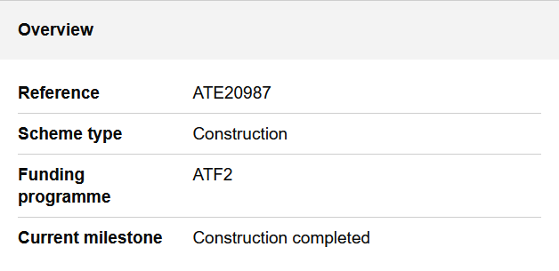
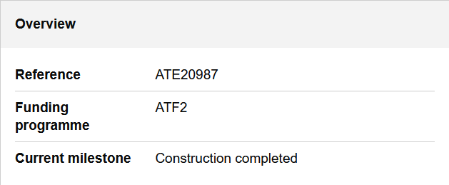
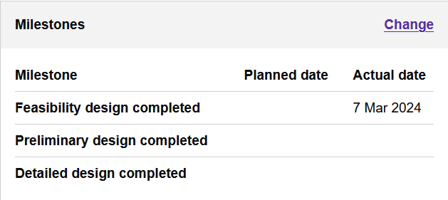
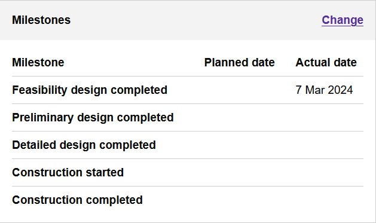
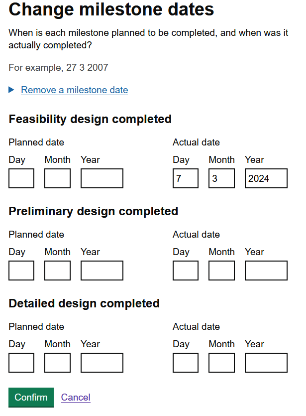
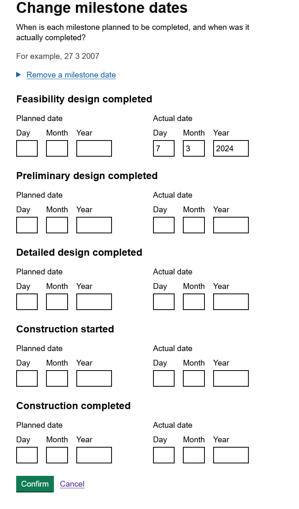

# 1.34.0 Release notes

## Removal of scheme type

As part of implementing the [new concept of capital scheme status](https://sites.google.com/dft.gov.uk/ate-database-refactoring/capital-scheme-records#h.9h55wtj3b1l8) 
we have moved away from capital schemes having a scheme type attribute. Historically, a scheme type would either be
development or construction and was shown in Update your capital schemes on the scheme page in the overview card.

With scheme type no longer being used we will therefore remove this item from the Overview card. We do not need to 
replace this item with capital scheme status because only capital schemes with an "active" status are shown in Update your capital schemes.

| Before                                            | After                                            |
|---------------------------------------------------|--------------------------------------------------|
|  |  |

## All milestones are available for updates

An immediate consequence of no longer using scheme type is that the milestones shown for a capital scheme will change 
for some capital schemes.

Previously, capital schemes of the scheme type development would only show a subset of possible milestones in the milestone
card on the schemes pages and only allow changes on the change milestone dates page for this subset. From 1.34.0 onwards
we will show all available milestones and allow authorities to update all milestones. This will allow authorities to
provide a more complete picture to ATE about the prospective timelines for a capital scheme regardless of whether
their historic funding was for construction or development.

| Before                                               | After                                              |
|------------------------------------------------------|----------------------------------------------------|
|  |  |

| Before                                                        | After                                                       |
|---------------------------------------------------------------|-------------------------------------------------------------|
|  |  |

