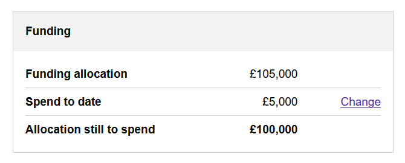
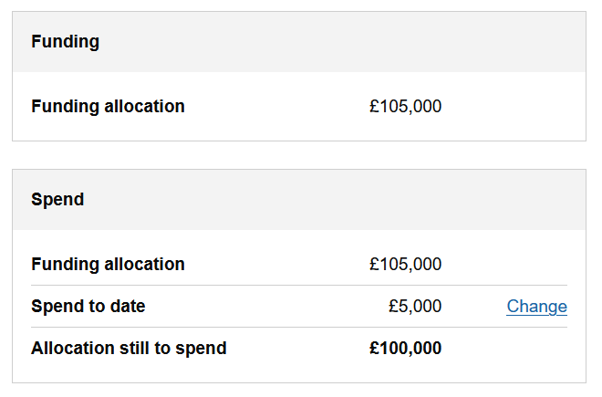

# 1.35.0 Release notes

## Split of capital scheme funding card into funding and spend

To allow for future changes that include the breakdown of the different sources of funding allocation for a scheme
this release splits the funding card into a funding card and spend card.

This moves spend to date and the link to the change spend to date form into a separate spend card which shows
the total funding allocation, current spend to date and the allocation still to spend. Funding allocation also
appears in the funding card which will be expanded in future releases to show the breakdown of funding sources.

| Before                                          | After                                          |
|-------------------------------------------------|------------------------------------------------|
|  |  |
